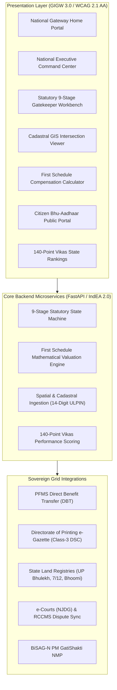

# NLAMS: Real-Time National Land Acquisition & Management System

> **Department of Land Resources (DoLR) | Ministry of Rural Development | Government of India**  
> *Developed for Smart India Hackathon (SIH)*

[](LICENSE)
[]()
[]()
[]()

---

## 📌 Problem Context & Institutional Imperatives
In India, acquiring land for linear and spatial public infrastructure (national highways, railways, and power grids) suffers an average judicial pendency of **20 years**, with **66% of all civil litigation** linked to land and property disputes. This bottleneck locks in capital equivalent to **1.3% of national GDP** annually.

**NLAMS** is a unified, microservice-based national enterprise portal that digitizes and automates the land acquisition lifecycle end-to-end under the **RFCTLARR Act, 2013** and sector-specific acts (**National Highways Act, 1956**, **Railways Act, 1989**).

---

## 🏛️ Core Architectural Modules



---

## ⚖️ Statutory 9-Stage Lifecycle Gatekeeper

1. **Proposal Ingestion & Alignment Scrutiny** (*RFCTLARR Sec 4 / NH Act Sec 3A*): Ingests GIS Right-of-Way alignments (KML/GeoJSON) and intersects with Survey of India cadastral maps.
2. **Social Impact Assessment (SIA)** (*RFCTLARR Sec 4–10*): Public hearing documentation, SIMP review, and 6-month statutory countdown clock.
3. **Preliminary Notification & Freezing** (*RFCTLARR Sec 11 / NH Act Sec 3A*): Bilingual draft schedule generation with Class-3 DSC digital signatures and automated 14-digit ULPIN encumbrance locking in State Land Registries.
4. **Objection Management & Inquiry** (*RFCTLARR Sec 15 / NH Act Sec 3C*): Quasi-judicial hearing calendar scheduler and reasoned disposal order archive.
5. **Declaration of Acquisition** (*RFCTLARR Sec 19 / NH Act Sec 3D*): Vesting in Government free from encumbrances with 12-month statutory deadline check.
6. **Valuation, Award & Compensation** (*RFCTLARR Sec 23, 26–30 / NH Act Sec 3G*): Automated mathematical computation of market rate, multiplication factor ($1.0\times\text{--}2.0\times$), assets, 100% Solatium, and 12% p.a. Additional Amount.
7. **Rehabilitation & Resettlement (R&R)** (*RFCTLARR Schedules II & III*): 11 mandatory monetary entitlements and 25 resettlement civic amenities tracker.
8. **Physical Possession & Mutation** (*RFCTLARR Sec 38 / NH Act Sec 3E*): Automated mutation API trigger to State Land Record Portals upon compensation verification.
9. **Dispute & Reference Monitoring** (*RFCTLARR Sec 51–74*): Synchronization with e-Courts and contingent liability financial modeling.

---

## 📐 First Schedule Compensation Formula

$$\text{Baseline Unit Rate } (MV) = \max\left(\text{Circle Rate}, \text{Top 50\% 3-Yr Registered Sale Deeds}, \text{PPP Consented Rate}\right)$$

$$MV_{\text{adjusted}} = MV \times \text{Multiplication Factor } (1.0\text{ to }2.0)$$

$$\text{Assets Valuation} = V_{\text{structures}} + V_{\text{trees}} + V_{\text{crops}}$$

$$C_{\text{Base}} = MV_{\text{adjusted}} + \text{Assets Valuation}$$

$$\text{Solatium (Sec 30(1))} = 100\% \times C_{\text{Base}}$$

$$\text{Additional Amount (Sec 30(3))} = 12\% \times MV \times \left(\frac{T_{\text{Award}} - T_{\text{Notification}}}{365}\right)$$

$$\mathbf{\text{Gross Total Compensation}} = C_{\text{Base}} + \text{Solatium} + \text{Additional Amount}$$

---

## 🏆 140-Point Vikas Performance Scoring Framework

- **Process Velocity (40 Points)**: Adherence to statutory stage turnaround limits.
- **Financial & PFMS DBT Efficiency (40 Points)**: Percentage of compensation disbursed directly via DBT.
- **Social Safeguards & R&R Delivery (40 Points)**: Execution of 11 monetary entitlements & 25 civic amenities.
- **Spatial Compliance & Mutation Velocity (20 Points)**: 14-digit ULPIN coverage & mutation completion within 30 days.
- **Penalty Deductions**: Automated point deductions for lapsed notifications or judicial stay orders.

---

## 🚀 Quick Start Guide

### Prerequisites
- Node.js (v18+)
- Python (v3.10+)

### 1. Start the FastAPI Backend
```bash
cd backend
python -m pip install -r requirements.txt
python -m uvicorn backend.main:app --host 0.0.0.0 --port 8000
```
- **Backend API**: `http://localhost:8000`
- **Interactive Swagger Docs**: `http://localhost:8000/docs`

### 2. Start the Frontend Web Portal
```bash
cd frontend
npm install
npm run dev
```
- **Frontend Portal**: `http://localhost:5173`

### 3. Run Automated Tests
```bash
python -m pytest backend/test_backend.py
```

---

## 📁 Repository Structure

```
├── backend/
│   ├── main.py                 # FastAPI application routes & middleware
│   ├── models.py               # Pydantic schemas (parcels, projects, valuation)
│   ├── valuation.py            # First Schedule statutory mathematical engine
│   ├── statutory_workflow.py   # 9-stage gatekeeper state machine
│   ├── spatial_cadastral.py    # GIS intersection & 14-digit ULPIN generator
│   ├── vikas_ranking.py        # DoLR 140-point performance ranking algorithm
│   ├── integrations.py         # PFMS DBT XML batch, e-Gazette, & state mutation
│   ├── seed_data.py            # Real-world infrastructure project seeds
│   ├── test_backend.py         # Automated pytest statutory suite
│   └── requirements.txt        # Python dependencies
├── frontend/
│   ├── src/
│   │   ├── App.jsx             # React master portal (Home, Workbench, GIS, etc.)
│   │   ├── index.css           # GIGW 3.0 compliant styling & design tokens
│   │   └── main.jsx            # Entry point
│   ├── index.html              # HTML shell with Google Fonts & Leaflet
│   └── package.json            # Node dependencies
├── pitch_kit/
│   ├── presentation_guide.md   # Presentation script for Team Leader (Girl 1)
│   ├── statutory_playbook.md   # Revenue nomenclature & Schedules for Researcher (Girl 2)
│   └── judge_qa_defense.md     # Bulletproof defenses for Pitcher (Girl 3)
└── README.md
```

---

## 👥 Smart India Hackathon (SIH) Team Distribution
- **Technical Lead / Backend Architect**: Microservices, 9-stage state machine, and First Schedule valuation math.
- **Team Leader (Girl 1)**: Presentation narrative and end-to-end user journey demonstration.
- **Researcher (Girl 2)**: RFCTLARR schedules, state nomenclature (Khasra, 7/12, Patta), and Vikas scoring.
- **Pitcher & Strategist (Girl 3)**: Judge Q&A defenses (ULPIN encumbrance locking, DBT transparency, e-Courts sync).
- **Cloud & DB Engineer (Boy 1)**: PostGIS database, GeoServer WMS/WFS, and Dockerization.
- **Frontend Contributor (Girl 4)**: React components and Leaflet GIS integration.
