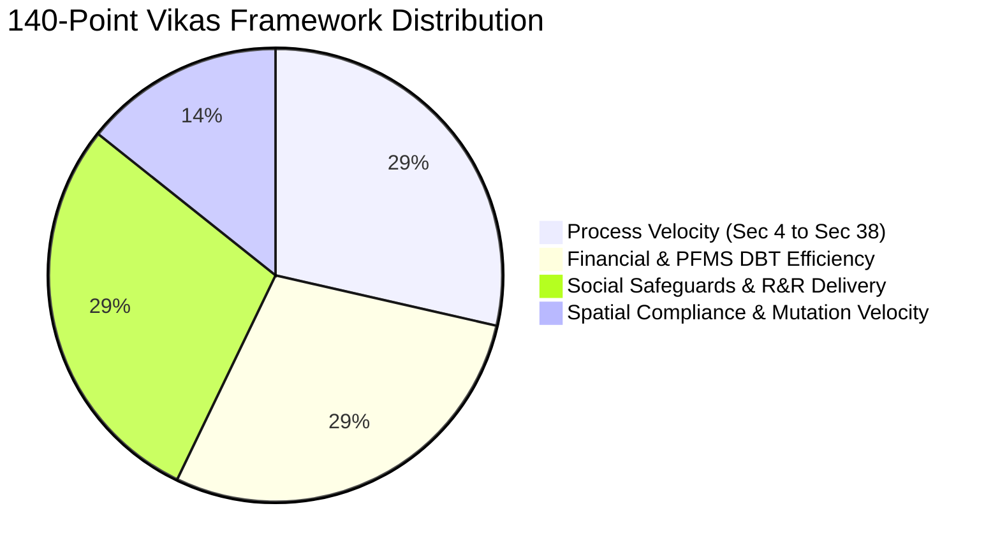

# NLAMS Statutory Reference & Domain Playbook
## Comprehensive Statutory Reference for Researcher (Girl 2)

---

## 1. RFCTLARR Act, 2013 Statutory Schedules Overview

| Schedule | Legal Purpose | NLAMS Implementation Engine |
| :--- | :--- | :--- |
| **First Schedule** | **Compensation for Land Owners (Sec 26–30)** | Automated valuation engine: $\max(\text{Circle Rate}, \text{Top 50\% 3-yr Deeds}, \text{PPP}) \times MF + \text{Assets} + 100\% \text{ Solatium} + 12\% \text{ Addl Amount}$. |
| **Second Schedule** | **11 Mandatory R&R Monetary Entitlements (Sec 31)** | 1. Subsistence grant (₹3,000/mo for 1 yr), 2. Transportation allowance (₹50,000), 3. Cattle shed grant, 4. One-time resettlement allowance, 5. Annuity / employment option, etc. |
| **Third Schedule** | **25 Mandatory Civic Infrastructural Amenities** | Digital checklist tracking completion of 25 amenities (Piped water, Anganwadi, Primary health sub-centre, electrified community hall, approach roads, cremation grounds). |
| **Fourth Schedule** | **Harmonization of Sector-Specific Acts** | Exemption list harmonized under RFCTLARR Removal of Difficulties Order (NH Act 1956, Railways Act 1989, Electricity Act 2003). |

---

## 2. The DoLR 140-Point Vikas Performance Scoring Matrix

The Department of Land Resources (DoLR) ranking matrix evaluates States & Districts across 4 primary pillars:

1. **Process Velocity (40 Points)**:
   - Evaluates adherence to statutory timelines (SIA completion within 6 months, Sec 19 Declaration within 12 months of Sec 11, Possession within 30 days of DBT).
2. **Financial & DBT Efficiency (40 Points)**:
   - Percentage of total award funds disbursed directly to landholders via PFMS DBT ($100\% = 40 \text{ pts}$). Penalizes idle parking in commercial CALA accounts.
3. **Social Safeguards & R&R Delivery (40 Points)**:
   - Execution rate of the 11 Second Schedule monetary entitlements and physical commissioning of Third Schedule civic amenities.
4. **Spatial Compliance & Mutation Velocity (20 Points)**:
   - Proportion of acquired parcels assigned 14-digit ULPINs, cadastral topological accuracy (zero slivers/overlaps), and revenue record mutation completion within 30 days of possession.
5. **Negative Marking Deductions**:
   - Automated deduction of **-2.5 points per stayed litigation or lapsed Sec 19 notification**.

---

## 3. Pan-India Revenue Nomenclature Normalization (DoLR GoRT Standard)

| Region / States | Land Parcel Record Name | Ownership Extract / Document | Revenue Cadastral Unit |
| :--- | :--- | :--- | :--- |
| **Uttar Pradesh, MP, Delhi, Bihar** | **Khasra / Khatauni** | RoR Extract (Bhulekh) | Bigha / Biswa / Sq. Meter |
| **Maharashtra, Gujarat** | **7/12 Extract (Saat-Baara)** | 8A Holding Sheet (Mahabhulekh) | Guntha / Hectare |
| **Karnataka** | **RTC (Pahani)** | Bhoomi Mutation Extract | Acre / Gunte |
| **Tamil Nadu, Andhra Pradesh** | **Patta / Chitta** | 'A' Register / Meebhoomi Adangal | Cent / Acre |
| **Punjab, Haryana** | **Jamabandi** | Khasra Girdawari (Fard) | Murabba / Kanal / Marla |
